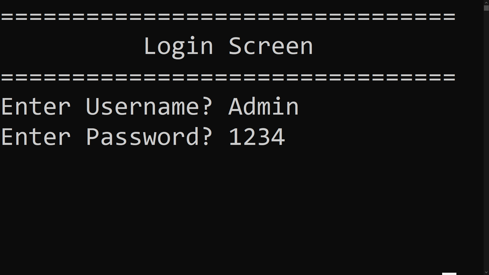
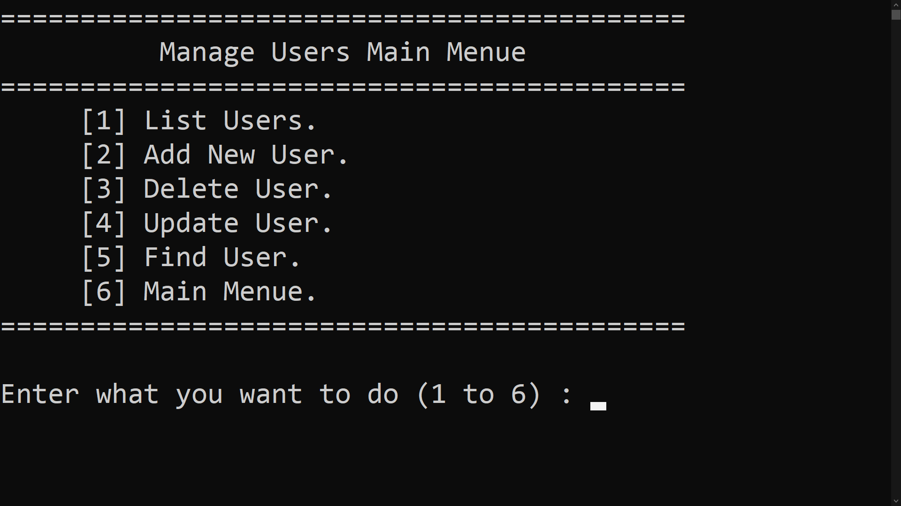

<div align="center">

# Bank Management System (C++)

A console-based bank management application written in C++, with client management, transactions, user login and permission-based access, all stored in plain text files.


</div>

---

## Table of Contents

- [About the Project](#about-the-project)
- [Features](#features)
- [Screenshots](#screenshots)
- [Getting Started](#getting-started)
- [How Permissions Work](#how-permissions-work)
- [Project Structure](#project-structure)
- [Data Storage](#data-storage)
- [Concepts Used](#concepts-used)
- [Known Limitations](#known-limitations)
- [Future Improvements](#future-improvements)
- [Version History](#version-history)
- [Author](#author)

---

## About the Project

This project is a simple bank management system that runs in the console. It was built as the final project of a C++ programming course, and it grew over three versions:

1. **v1:** client management (add, delete, update, find, list).
2. **v2:** deposits, withdrawals and total balance.
3. **v3:** user login, user management, permissions, and a full restructure into separate modules.

---

## Features

### Client management
- Show the list of all clients in a formatted table
- Add new clients (with a check that the account number is unique)
- Delete clients
- Update client information
- Find a client by account number

### Transactions
- Deposit money into a client's account
- Withdraw money (blocked if the balance is not enough)
- Show the total balance of all clients

### Users and security
- Login screen with username and password
- Add, delete, update, find and list users
- Permission system: give each user full access or only the options they need
- Access denied screen when a user tries something they are not allowed to do
- Logout and login as another user
- A default **Admin** account is created automatically the first time the program runs

---

## Screenshots

| Login | Main menu |
|---|---|
|  |  |

| Transactions menu | Manage users |
|---|---|
|  |  |

---

## Getting Started

### Requirements
- Windows
- Visual Studio 2022 with the **Desktop development with C++** workload

### Run the project
1. Clone the repository:
   ```bash
   git clone https://github.com/hasanhlala/Bank-Management-System-CPP.git
   ```
2. Open `Project1Course7.sln` in Visual Studio.
3. Build the solution with **Ctrl + Shift + B**.
4. Run it with **Ctrl + F5**.

### First login

When the program starts for the first time and no users exist, it creates this account:

| Username | Password | Access |
|---|---|---|
| `Admin` | `1234` | Full access |

Log in with it, then open **Manage Users** to create your own users. The `Admin` account cannot be deleted.

---

## How Permissions Work

Each user has one number that stores all their permissions. Every permission is a single bit, so they can be combined with bitwise OR (`|`) and checked with bitwise AND (`&`).

| Permission | Value |
|---|---|
| Show client list | 1 |
| Add new client | 2 |
| Delete client | 4 |
| Update client | 8 |
| Find client | 16 |
| Transactions | 32 |
| Manage users | 64 |
| **Full access** | **-1** |

For example, a user who can only list clients and use transactions has the permission value `1 + 32 = 33`.

The check is done in one line:

```cpp
(CurrentUser.Permission & Permission) == Permission
```

---

## Project Structure

The code is split into modules, each with a header (`.h`) and a source file (`.cpp`):

```
.
├── main.cpp            Entry point, calls StartTheProgram()
├── Common.h/.cpp       File names, string splitting, shared helper screens
├── Clients.h/.cpp      Client struct and all client operations
├── Transactions.h/.cpp Deposit, withdraw, total balance and their menu
├── Users.h/.cpp        Users, login, permissions and user management
├── Menus.h/.cpp        Main menu and task handling
├── screenshots/        Images used in this README
└── Project1Course7.sln Visual Studio solution
```

---

## Data Storage

Data is saved in two text files that the program creates and updates next to the executable. Each record is one line, and fields are separated by `/#/`.

**ClientsData**
```
AccountNumber/#/PinCode/Name/Phone/Balance
```

**UsersFile**
```
Username/#/Password/Permission
```

These files are listed in `.gitignore`, so real data is never uploaded to the repository.

---

## Concepts Used

- Structs and enums
- Vectors and strings
- File handling with `fstream`
- Parsing and splitting records
- Bitwise operators for permissions
- Splitting a program into header and source files
- Function prototypes and global state (`extern`)
- Input validation and menu-driven design

---

## Known Limitations

- Passwords are stored as plain text
- Data is kept in text files, not in a database
- Windows only, because it uses `cls` and `pause`
- Account balances are whole numbers (`int`)

---

## Future Improvements

- Hash passwords instead of storing them in plain text
- Use `enum class` for stronger type safety
- Support decimal balances
- Add transfer between accounts and a transaction history
- Replace the text files with a database such as SQLite
- Make it cross-platform

---

## Version History

| Version | What was added |
|---|---|
| **v3.0** | Login, user management, permissions, modular code structure |
| **v2.0** | Transactions: deposit, withdraw, total balance |
| **v1.0** | Client management |

---

## Author

**Hasan Hlala**

- GitHub: [@hasanhlala](https://github.com/hasanhlala)
