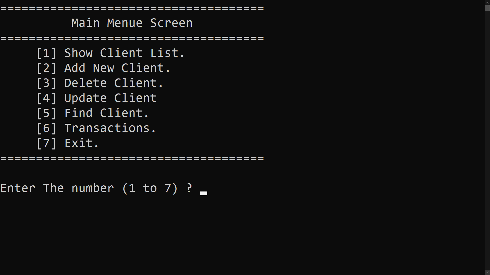
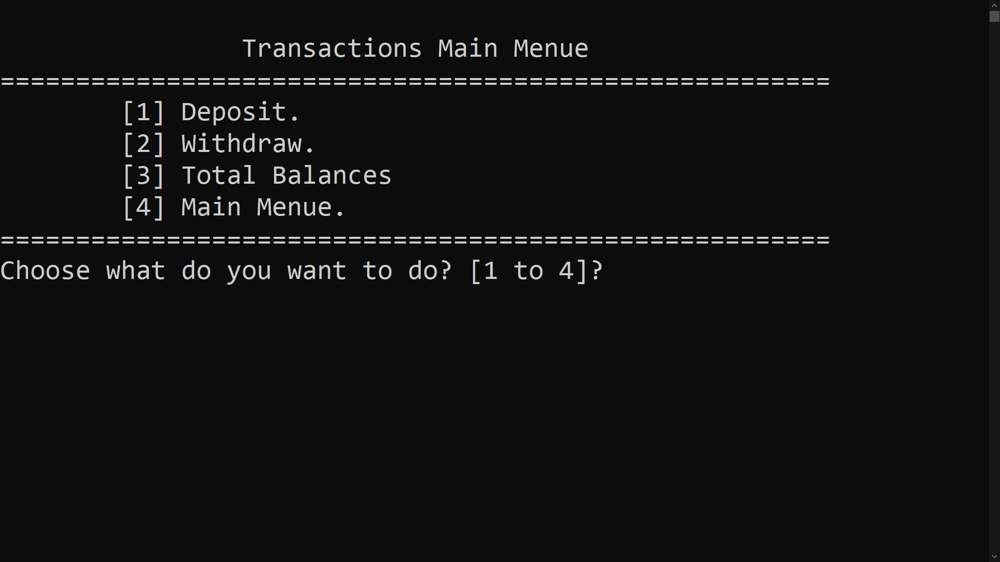

<p align="center">
  A console-based bank management application written in C++,<br>
  with client management, transactions and file-based storage.
</p>

<p align="center">
  
  
  
  
</p>

---

## Table of contents
- [Overview](#overview)
- [Features](#features)
- [Screenshots](#screenshots)
- [Getting started](#getting-started)
- [Usage](#usage)
- [Data format](#data-format)
- [Project structure](#project-structure)
- [Versions](#versions)
- [What I learned](#what-i-learned)
- [Roadmap](#roadmap)
- [Credits](#credits)
- [Author](#author)

## Overview

This project simulates the core of a small bank system. A bank employee can manage client accounts from a text-based menu and perform deposits and withdrawals. All data is stored in a plain text file, so no database is required.

It was built as the end-of-course project for Course 7 of the Programming Advices C++ track (v1.0), then extended with a full transactions module (v2.0).

## Features

**Client management (v1.0)**
- Add new clients, with a duplicate account number check
- Show all clients in a formatted table
- Update client information
- Delete clients, with confirmation
- Find a client by account number

**Transactions (v2.0)**
- **Deposit:** add money to a client account
- **Withdraw:** withdraw money, blocked when the amount exceeds the balance
- **Total Balances:** list every client's balance with the total sum
- Y/N confirmation before every transaction
- Input validation for menu choices and amounts
- Clean exit from the main menu

## Screenshots

| Main menu | Transactions menu |
|:---:|:---:|
|  |  |

## Getting started

### Requirements
- Windows
- Visual Studio 2022 with the **Desktop development with C++** workload

> The program uses `system("cls")` and `system("pause")`, so it targets Windows.

### Build and run
```bash
git clone https://github.com/hasanhlala/Bank-Management-System-CPP.git
```
1. Open `Project1Course7.sln` in Visual Studio.
2. Press **Ctrl + F5** to build and run.

The program reads and writes a file named `ClientsData` in the working directory. If the file does not exist, it is created when you add the first client.

## Usage

```
==========================================
          Main Menu Screen
==========================================
     [1] Show Client List.
     [2] Add New Client.
     [3] Delete Client.
     [4] Update Client.
     [5] Find Client.
     [6] Transactions.
     [7] Exit.
==========================================
```

Choosing **Transactions** opens a second menu:

```
     [1] Deposit.
     [2] Withdraw.
     [3] Total Balances.
     [4] Main Menu.
```

## Data format

Each client is stored on one line. Fields are separated by `/#/`:

```
AccountNumber/#/PinCode/#/Name/#/Phone/#/Balance
```

Example with sample data:

```
A101/#/1234/#/Sample Client/#/0999000000/#/5000.000000
```

## Project structure

```
.
├── Source.cpp              # Program entry point, menus and logic
├── ClientsData             # Data file, one client per line
├── Project1Course7.sln     # Visual Studio solution
└── screenshots/            # Images used in this README
```

## Versions

| Version | Description |
|---|---|
| [v1.0](../../releases/tag/v1.0) | Client management: add, show, update, delete, find |
| [v2.0](../../releases/tag/v2.0) | Adds the Transactions menu: deposit, withdraw, total balances |

## What I learned

- Designing menu-driven programs with `enum` and `switch`
- Using `struct` and `vector` to model and process records
- Reading and writing files with `fstream` and parsing delimited records
- Formatting console tables with `<iomanip>` (`setw`, `left`)
- Passing data by reference and splitting logic into small functions
- Validating user input and handling not-found cases safely
- Git workflow: small commits, tags and GitHub releases

## Roadmap

- [ ] PIN verification before transactions
- [ ] Transaction history log
- [ ] Transfer between accounts
- [ ] Portable screen clearing instead of `system("cls")`

## Credits

Based on the C++ course by Dr. Mohammed Abu-Hadhoud (Programming Advices). The transactions module was added as the second project of Course 7.

## Author

**Hassan Hlala**
Information Engineering student at Tishreen University, Syria

GitHub: [@hasanhlala](https://github.com/hasanhlala)
